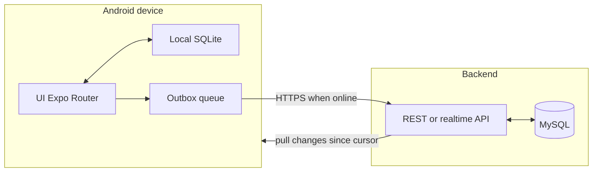

# Sukli

Offline-first store management for **sari-sari** (neighborhood convenience) stores in the Philippines: inventory, sales, suppliers, simple insights, and smart restocking hints that work on low-end Android devices with unreliable connectivity.

## Stack (monorepo)

- **Monorepo:** npm workspaces
- **Mobile:** Expo SDK 54 · React Native 0.81 · Expo Router · TypeScript
- **Backend:** Node.js + Express + TypeScript + MySQL (`mysql2`)
- See [Expo documentation](https://docs.expo.dev/) and [React Native documentation](https://reactnative.dev/docs/getting-started)

---

## 1. System architecture (mobile + backend + sync)

High-level: **local SQL is the source of truth while offline**; the app **queues mutations** and **syncs** to a small cloud API when the network is available. The server stores the **canonical multi-device / backup** state and optional **aggregates** for insights.



**Layers**

| Layer            | Role                                                         |
| ---------------- | ------------------------------------------------------------ |
| **Presentation** | Screens, components; no business rules in navigation         |
| **Domain**       | Entities, use-cases (e.g. “record sale”, “apply sync batch”) |
| **Data**         | Local SQLite repositories, remote API client, sync engine    |
| **Sync**         | Outbox writer, batch uploader, downloader, conflict policy   |

**Why this shape:** Keeps UI testable, isolates “what happens when I’m offline” in one place, and lets you swap the host (Supabase vs self-hosted) without rewriting the app core.

---

## 2. Low-cost backend stack (solo-friendly)

**Current setup in this repo:** **Express + MySQL** in `apps/backend`.

- Uses `mysql2` with pooled connections and env-based configuration.
- Keeps control simple for a solo developer while preserving SQL-first modeling.
- For hosting later: start with Railway/Render/Fly or a low-cost VPS + managed MySQL.

---

## 3. Local database (offline-first React Native)

**Recommendation: SQLite on-device via `expo-sqlite` + a typed layer (e.g. [Drizzle ORM](https://orm.drizzle.team/) with `expo-sqlite` / `drizzle-orm/expo-sqlite`).**

| Choice                 | Why                                                                                                  |
| ---------------------- | ---------------------------------------------------------------------------------------------------- |
| **SQLite**             | Same relational model as Postgres; small footprint; works on low-end devices; battle-tested in Expo. |
| **Drizzle (optional)** | Shared schema types with server-side Postgres via `drizzle-kit` push; fewer runtime surprises.       |

**Alternatives**

- **WatermelonDB** — Strong for large offline datasets and sync; steeper learning curve and more opinionated structure.
- **Realm** — Good but another query model and licensing/hosting considerations for sync.

**Avoid** relying on only `AsyncStorage` for inventory/sales; you need **transactions**, **indexes**, and **queryable history**.

---

## 4. Sync strategy (offline → online)

**Core pattern: [Outbox](https://martinfowler.com/articles/201701-event-driven.html)** — every mutation appends to a local **`sync_outbox`** (and updates the entity in a transaction). A background worker uploads batches when connectivity returns.

**Identifiers**

- Use **UUIDs** (v4 or v7) for primary keys client-generated to avoid collisions across devices.
- Per store: **`store_id`** on all tenant rows.

**Ordering**

- Each event row: **`created_at`**, **`client_mutation_id`** (monotonic per device), optional **`server_version`** after ack.

**Conflict handling (pragmatic MVP)**

| Data type                        | Policy                                                                                                                                                  |
| -------------------------------- | ------------------------------------------------------------------------------------------------------------------------------------------------------- |
| **Product name, supplier phone** | Last-write-wins using `updated_at` + server timestamp on merge                                                                                          |
| **Stock quantity**               | Prefer **merge**: `server_qty = server_qty + delta` from **mutation intent** (sold 3, received 10) instead of overwriting absolute counts when possible |
| **Sales / ledger**               | **Append-only**; conflicts are rare if sales are immutable facts; never delete—use **void** or **reversal** rows                                        |

**Retries**

- Exponential backoff + jitter; cap retries; **dead-letter** queue in UI for “failed to sync” with **Retry** button.
- **Idempotency** keys on the server for each `client_mutation_id` so duplicate posts are safe.

**Consistency model**

- **Offline:** **Read-your-writes** locally; **eventual consistency** with server.
- **“Real-time insights”:** Show **local** aggregates immediately; refresh from server when sync completes; label “**As of last sync**” when stale.

**Optional later:** [PowerSync](https://www.powersync.com/) or **ElectricSQL** if you outgrow custom sync—adds cost/complexity; not required for MVP.

---

## 5. Database schema (sketch)

**Server (MySQL) and local (SQLite)** should mirror the same tables where possible (subset of columns is OK on device).

**Tenant**

- `stores` — `id`, `name`, `owner_user_id`, `region`, `created_at`, …
- `users` — managed by Supabase Auth; optional `profiles` table linked to `auth.users`.

**Catalog & inventory**

- `products` — `id`, `store_id`, `name`, `sku`, `unit`, `barcode`, `cost_price_cents`, `sell_price_cents`, `reorder_level`, `updated_at`, `deleted_at`
- `inventory_movements` — `id`, `store_id`, `product_id`, `qty_delta`, `reason` (sale, delivery, adjustment, waste), `ref_id` (sale_line id, etc.), `created_at`

**Sales**

- `sales` — `id`, `store_id`, `sold_at`, `total_cents`, `payment_method`, `customer_note`, `created_at`
- `sale_lines` — `id`, `sale_id`, `product_id`, `qty`, `unit_price_cents`, `line_total_cents`

**Suppliers & purchases**

- `suppliers` — `id`, `store_id`, `name`, `phone`, `notes`, `updated_at`
- `purchases` — `id`, `store_id`, `supplier_id`, `purchased_at`, `total_cents`, `invoice_ref`
- `purchase_lines` — `id`, `purchase_id`, `product_id`, `qty`, `unit_cost_cents`

**Sync & device**

- `sync_outbox` (local) — `id`, `payload`, `entity`, `created_at`, `retry_count`, `last_error`
- `sync_state` (local) — `last_cursor` or `last_server_seq` per store

**Price intelligence (see §6)**

- `price_snapshots` — `id`, `store_id`, `product_id`, `source` (manual, aggregate, api), `price_cents`, `observed_at`, `region_hint`
- (Optional) `price_sources` — metadata for auditing

**Indexes:** `(store_id, sold_at)` on `sales`, `(store_id, product_id)` on `products`, `(store_id, observed_at)` on `price_snapshots`.

---

## 6. Grocery list & price intelligence

**Behavior**

- **Offline:** Suggestions from **last known** prices + **rules** (e.g. below reorder level, velocity from local sales).
- **Online:** Pull **refreshed** `price_snapshots` for the region/product category; merge into SQLite.

**Data sources (MVP → scale)**

1. **Manual entry** — Store owner sets “last known price” or cost; always trusted for _their_ store.
2. **Derived from purchases** — When they log a purchase, update `price_snapshots` with `source = purchase`.
3. **Anonymous aggregates** — **Opt-in** “share price ranges to help neighbors” — server stores **bucketed** stats by region + product category (no raw PII). **Privacy policy + consent** required.
4. **External APIs** — If you later integrate **government or retail** open data (where available), ingest via Edge Function cron jobs.
5. **Crowdsourcing** — “Confirm price” micro-flow after a purchase; gamify lightly (badges), not cash at first—reduces fraud risk.

**Do not** promise “accurate market prices” until you have enough density; **UI copy** should say **“estimated”** or **“based on your area and similar stores.”**

---

## 7. Performance on low-end Android

- **Lists:** `FlatList`/`FlashList` with `windowSize`, `getItemLayout` when stable row height, avoid inline heavy work in `renderItem`.
- **Images:** `expo-image` with size caps; avoid huge hero assets on dashboard.
- **JS thread:** Precompute aggregates in SQLite (SUM/COUNT) or in a worker batch, not on every keystroke.
- **Animations:** Reanimated is fine; keep effects subtle on low-end devices.
- **Bundle:** Lazy routes; avoid importing large libraries on cold start.
- **SQLite:** Batch writes; avoid N+1 queries; index foreign keys.
- **Hermes:** Enabled by default in modern Expo—keep it on.

---

## 8. Monetization (if you sell this)

| Model                  | Fit                                                                                             |
| ---------------------- | ----------------------------------------------------------------------------------------------- |
| **Freemium**           | Free 1 store, 1 device; paid multi-device, backup, advanced reports                             |
| **Subscription (PHP)** | Monthly low price aligned with sari-sari margins; **carrier billing** or **GCash / Maya** later |
| **B2B / distributor**  | White-label for a wholesaler (“order from us” inside app)—requires trust and compliance         |
| **Data**               | Only if **aggregated** and **opt-in**; never sell identifiable rows without consent             |

Start with **simple subscription + clear value** (backup + multi-device + supplier features).

---

## 9. Roadmap alignment (this repo)

This repository is now a **monorepo**:

```
apps/
  mobile/   # Expo React Native app
  backend/  # Express + TypeScript + MySQL API
packages/   # reserved for shared libs/types
```

**Next implementation steps (suggested)**

1. Add SQLite + schema migrations (local).
2. Implement core CRUD for products, sales, suppliers **without** network.
3. Add outbox + fake sync to a dev API.
4. Wire Supabase Auth + Postgres tables + RLS.
5. Build sync worker + conflict rules for stock and sales.
6. Add price snapshot cache + optional aggregate fetch.

---

## Bonus A — “Must-have” features for owners

- **Voice input** for low-literacy users (product name, quantity)—with confirmation.
- **Big, thumb-friendly POS** and **daily summary** in one tap.
- **Utang (credit) ledger** — sensitive; simple balance per person; huge daily value.
- **Load / e-wallet / bills** tracking if they sell digital services—**high frequency** use.
- **Wholesale pack sizes** (tingi vs whole pack) — matches real sari-sari behavior.
- **SMS/WhatsApp** share of daily summary (export image, not spammy automation without consent).

---

## Bonus B — Platform expansion

- **Fintech:** Float / working capital only after **verified** cashflow history and **partner** bank; start with **education** and **referrals**, not lending yourself.
- **Distributor marketplace:** “Reorder from supplier” when you have density; take **small take rate**.
- **Data products:** **Anonymized** regional demand trends for FMCG brands—**opt-in** and contractual.

---

## Bonus C — Monorepo status

Monorepo migration is implemented with npm workspaces. Next recommended additions:

- `packages/shared` for DTO/types/validation schemas
- `packages/db` for SQL migrations and query helpers
- optional Turborepo when CI time starts growing

---

## Product workflow note

For multi-phase delivery (plan → build → test → ship), you can use a structured workflow skill such as `concise-planning` + `verification-before-completion` alongside this document; the **execution playbook** is the sections above.

---

## Local development

```bash
npm install
npm run mobile:start
```

Run backend (MySQL required):

```bash
cp apps/backend/.env.example apps/backend/.env
npm run backend:dev
```

Backend health endpoint:

```bash
http://localhost:4000/health
```

Use **Android** device or emulator for representative performance testing.

---

## License

Private unless you specify otherwise.
